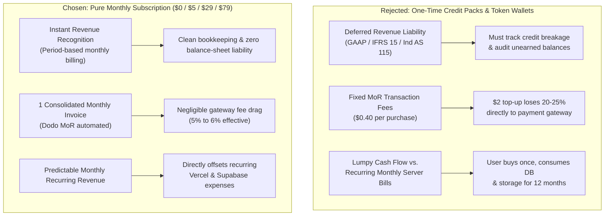

# Chat2Sell — Payment, Pricing & Unit Economics Model

> **Status**: Approved Financial & Commercial Architecture Reference  
> **Last Updated**: November 2026  
> **Canonical Domain**: [chat2sell.in](https://chat2sell.in)  
> **Merchant of Record**: Dodo Payments  

---

## 1. Executive Summary & Core Business Policies

This document serves as the official financial architecture, pricing rationale, and unit economics model for **Chat2Sell** (`chat2sell.in`). It is written for founders, engineers, and AI agents to explain the exact commercial choices, cost structures, and operational policies governing platform monetization.

### Key Business Policies:

1. **Pure Recurring Monthly Subscription (Zero Hybrid / Zero One-Time Packs)**:
   - All paid plans are recurring monthly subscriptions ($5, $29, $79).
   - Monthly simulation quotas reset automatically on the **1st of each calendar month at 00:00 UTC**.
   - One-time credit top-ups, token packs, and pay-as-you-go meters are **strictly rejected** to keep accounting, taxation, and billing simple and audit-proof.
2. **Quota Exhaustion Policy (Hard Stop / Zero Overage Fees)**:
   - When a workspace exhausts its monthly simulation quota:
     - The user may upgrade to a higher tier (if available).
     - If the workspace is already on the highest plan (Scale) or chooses not to upgrade: **Access to create new simulations halts until the 1st of the next calendar month**.
     - We do not offer ad-hoc token top-ups, API overages, or metered billing. We deliberately leave microtransaction revenue on the table to avoid billing complexity, dispute overhead, and credit breakage audits.
3. **Mid-Cycle Cancellation & Period-End Access**:
   - If a customer cancels on Day 10 of their 30-day billing cycle, their subscription and benefits remain active until Day 30.
   - On Day 30, the workspace automatically reverts to the Free Starter tier. Historical transcripts and analytics remain preserved.
   - No prorated refunds are issued for voluntary mid-cycle cancellations (aligned with [`app/refund/page.tsx`](file:///home/gourab/coding/saleschat/app/refund/page.tsx)).
4. **Merchant of Record (MoR) Model via Dodo Payments**:
   - Dodo Payments acts as the Merchant of Record, handling global invoicing, fraud mitigation, US state sales taxes, and EU/UK VAT.
   - Payouts sent to India qualify as **Zero-Rated B2B Export of Software Services** under an active GST Letter of Undertaking (LUT), incurring **0% Indian GST**.
5. **Dual Currency & Domestic Indian Payments (USD Base + INR Localized)**:
   - Pricing is pegged to USD ($5, $29, $79) for international customers.
   - For Indian customers, Dodo Payments serves localized INR pricing (e.g., ₹399 Solo, ₹1,999 Team, ₹5,499 Scale) supporting UPI, RuPay, and domestic debit cards without foreign exchange transaction blocks.

---

## 2. Why Pure Subscription Beats One-Time Payments (Accounting & Audit Defense)



### Detailed Rationale:

| Dimension | Pure Monthly Subscription (Chosen) | One-Time / Credit Packs (Rejected) |
| :--- | :--- | :--- |
| **Accounting & Tax Audits** | **Simple period-based revenue**: 1 transaction = 30 days of service. Recognized in the month billed. Clean Indian income tax and GST compliance. | **Complex unearned revenue**: Unused credits must be logged on balance sheets as deferred liabilities until consumed or expired. Requires token audit tracking. |
| **Payment Gateway Economics** | **Minimal fee drag**: On a $29 Team plan, Dodo's $0.40 fixed fee is only **1.3%** of revenue. | **Severe fee erosion**: On a $2 or $3 one-time pack, the $0.40 fee instantly takes **15% to 20%** of the gross sale before AI compute costs. |
| **Infrastructure Alignment** | **Cost matching**: Vercel ($20/mo) and Supabase ($25/mo) bill monthly. Monthly subscription revenue directly covers recurring hosting costs. | **Cost mismatch**: A user could pay $3 once and continue logging in, storing chat transcripts, and utilizing Supabase auth for years. |
| **Legal Consistency** | **100% aligned with existing legal pages**: Matches the terms already deployed in [`app/refund/page.tsx`](file:///home/gourab/coding/saleschat/app/refund/page.tsx) and [`app/terms/page.tsx`](file:///home/gourab/coding/saleschat/app/terms/page.tsx) (period-end service, no mid-cycle prorating, automatic fallback to free). | **Requires rewriting legal terms**: Would require drafting token expiration rules, partial credit refund calculators, and forfeiture clauses. |

---

## 3. Real Provider Cost Research & Web Documentation

All costs below were researched from current live production pricing tables:

| Provider | Service / Endpoint | Model / Product | Live Pricing Rate | Documentation & Source Links |
| :--- | :--- | :--- | :--- | :--- |
| **Groq** | Persona Simulation & Detailed Coaching | `qwen/qwen3.8-27b` | **$0.80** / 1M Input<br/>**$4.00** / 1M Output | [Groq Model Pricing](https://groq.com/pricing/)<br/>*(Prompt caching provides up to 50% discount on repeated prompt contexts)* |
| **TypeSafe AI** | Automated Jev Outcome Evaluation | Jev ("System One") | **$0.042** / 1M Input<br/>**$0.00 (Free Output)** | [TypeSafe AI Official](https://typesafe.ai)<br/>*(Non-autoregressive state classifier; output tokens are free)* |
| **Supabase** | Multi-tenant DB, Auth & Storage | Pro Plan | **$25.00 / month** flat | [Supabase Pricing](https://supabase.com/pricing)<br/>*(Includes 100,000 MAU, 8GB DB, 250GB egress, and $10 compute credit covering the default Micro instance)* |
| **Vercel** | Next.js Frontend & API Hosting | Pro Plan | **$20.00 / month** flat | [Vercel Pricing](https://vercel.com/pricing)<br/>*(Includes 1 TB bandwidth, Edge middleware, serverless functions, and commercial usage license)* |
| **Upstash** | Distributed Redis Rate Limiter & Cache | Pay-as-you-go | **$0.20** / 100k commands<br/>*(~$2 to $4 / month)* | [Upstash Redis Pricing](https://upstash.com/pricing/redis)<br/>*(Free tier covers 10,000 commands/day during development)* |
| **Dodo Payments** | Merchant of Record (MoR) | Global Digital SaaS | **4.0% + $0.40** (US)<br/>**+0.5%** (Subscriptions)<br/>**4.0% + $0.15** (India) | [Dodo Payments Pricing](https://dodopayments.com/pricing)<br/>*(Includes global tax compliance, automated invoicing, customer portal)* |
| **Indian Tax (GST)** | Export of Software Services | B2B to Dodo Payments | **0% GST (Zero-Rated)** | [CBIC GST Export Guidelines](https://cbic-gst.gov.in)<br/>*(Filing Letter of Undertaking / LUT under CGST Act Section 16)* |

---

## 4. Single Simulation Unit Economics (Conservative 25k-Token Stress Test)

Because LLMs are stateless, every message sent during a simulation requires passing the persona prompt, past conversation history, and the new user message. Context compounds on every turn.

To ensure extreme financial safety, we model costs not on an ideal chat, but under a **conservative upper-bound stress test of 20,000 to 25,000 input tokens per conversation**:

```text
Conservative Cost Breakdown for a Single Completed Simulation (Qwen 27B 3.8 on Groq):

  1. Interactive Persona Generation (20,000 - 25,000 Cumulative Input Tokens):
     • Input Tokens  : 25,000 tokens / 1,000,000 × $0.80 = $0.0200 (2.00¢)
     • Output Tokens :  2,000 tokens / 1,000,000 × $4.00 = $0.0080 (0.80¢)
     ------------------------------------------------------------------------
     Groq Conversation Generation Subtotal               = $0.0280 (2.80¢)

  2. Automated Turn Evaluation (TypeSafe AI Jev):
     • Sliding Window Input : 15 turns × 600 tokens = 9,000 tokens
     • Input Tokens  :  9,000 tokens / 1,000,000 × $0.042 = $0.00038 (0.04¢)
     • Output Tokens :  $0.00 (Non-autoregressive output is free)
     ------------------------------------------------------------------------
     TypeSafe AI Jev Subtotal                            = $0.00038

  3. Detailed AI Coaching Breakdown (Groq, on session completion):
     • Transcript Input : 2,500 tokens / 1,000,000 × $0.80 = $0.0020 (0.20¢)
     • Feedback Output  : 1,000 tokens / 1,000,000 × $4.00 = $0.0040 (0.40¢)
     ------------------------------------------------------------------------
     Detailed Coaching Subtotal                          = $0.0060 (0.60¢)

  ===========================================================================
  CONSERVATIVE TOTAL COST PER SIMULATION (With Coaching): ~$0.0344 (~3.44¢ USD)
  BASELINE COST PER SIMULATION (Average 10-turn chat)   : ~$0.0207 (~2.07¢ USD)
  ===========================================================================
```

---

## 5. Official 4-Tier Subscription Matrix

| Dimension / Limit | **Starter** (Free) | **Solo** (Indie Rep) | **Team** (Small Pod) | **Scale** (Growth / Org) |
| :--- | :---: | :---: | :---: | :---: |
| **Target Audience** | Individual trying the tool | Solo SDRs, indie sales reps, freelancers | Sales pod, small SDR team, agency (2–10 reps) | Scaling sales org, revenue teams (10–50 reps) |
| **Monthly Price (USD)** | **$0** (Free forever) | **$5 / month** | **$29 / month** | **$79 / month** |
| **Monthly Price (INR - India)**| **₹0** | **₹399 / month** | **₹1,999 / month** | **₹5,499 / month** |
| **Effective Seat Price** | — | $5.00 / seat | **$2.90 / seat** (at 10 seats) | **$1.58 / seat** (at 50 seats) |
| **Included Team Seats** | **1 Seat** (Personal only) | **1 Seat** (Personal only) | **Up to 10 Seats** | **Up to 50 Seats** |
| **Simulations / Month (Org Pool)** | **10 Simulations** | **50 Simulations** | **200 Simulations** | **600 Simulations** |
| **Automated Jev Win/Loss & Score** | ✅ Included | ✅ Included | ✅ Included | ✅ Included |
| **Detailed AI Coaching Breakdown** | ❌ Locked (Upgrade hook) | ✅ Unlimited | ✅ Unlimited | ✅ Unlimited |
| **Team Oversight Dashboard** | ❌ Personal stats only | ❌ Personal stats only | ✅ Full Team Visibility | ✅ Full Team Visibility |
| **Rep Benchmarks & Leaderboards** | ❌ Locked | ❌ Locked | ✅ Included | ✅ Included |
| **Manager Transcript Inspection** | ❌ Locked | ❌ Locked | ✅ Included | ✅ Included |
| **Quota Exhaustion Behavior** | Upgrade to Solo | Upgrade to Team or wait | Upgrade to Scale or wait | Sit back & wait for monthly reset |
| **Safety Token Ceiling (`ai-usage.ts`)**| 300,000 tokens | 1,500,000 tokens | 6,000,000 tokens | 20,000,000 tokens |

---

## 6. Financial Feasibility & Margin Stress Testing

### Scenario A: Ultra-Conservative Stress Test (25k Tokens + 100% Quota Utilization)
Assuming **every single customer consumes 100% of their monthly simulation quota** under the heavy **25,000-token conservative cost ($0.0344/sim)**:

| Tier | Monthly Price | MoR Fee (4.5% + $0.40) | Compute Cost (at $0.0344/sim) | Net Monthly Profit | Gross Margin |
| :--- | :---: | :---: | :---: | :---: | :---: |
| **Solo** (50 sims) | $5.00 | $0.63 | $1.72 | **+$2.65** | **53.0%** |
| **Team** (200 sims) | $29.00 | $1.71 | $6.88 | **+$20.41** | **70.4%** |
| **Scale** (600 sims) | $79.00 | $3.96 | $20.64 | **+$54.40** | **68.9%** |

> [!TIP]
> Even under this aggressive 25k-token stress test with 100% quota utilization, **every single paid tier remains comfortably above your 50% gross margin target** (Solo is 53.0%, Team is 70.4%, Scale is 68.9%).

### Scenario B: Typical Real-World Utilization (~50% Usage)
In real SaaS environments, average monthly quota utilization is ~40% to 60%:

| Tier | Monthly Price | MoR Fee | Compute Cost (at 50% usage) | Net Monthly Profit | Gross Margin |
| :--- | :---: | :---: | :---: | :---: | :---: |
| **Solo** (25 sims used) | $5.00 | $0.63 | $0.86 | **+$3.51** | **70.2%** |
| **Team** (100 sims used) | $29.00 | $1.71 | $3.44 | **+$23.85** | **82.2%** |
| **Scale** (300 sims used) | $79.00 | $3.96 | $10.32 | **+$64.72** | **81.9%** |

---

## 7. Fixed Infrastructure Overhead & Break-Even Analysis

When transitioning to paid infrastructure to support production customers:

```text
Fixed Monthly Infrastructure Baseline:
  • Vercel Pro (commercial license, 1 TB bandwidth) : $20.00 / month
  • Supabase Pro (100k MAU, 8 GB DB, daily backups) : $25.00 / month
  • Upstash Redis (rate limiting & caching)         : ~$3.00 / month
  • Domain (chat2sell.in renewal)                  : ~$1.00 / month
  --------------------------------------------------------------------
  Total Fixed Baseline Overhead                    : ~$49.00 / month
```

### Break-Even Thresholds (Under the 25k-Token Conservative Model):
To completely cover the entire $49/month fixed hosting bill, Chat2Sell requires only:
- **1 Scale Customer** ($54.40 net) $\rightarrow$ **Infrastructure 100% covered + $5.40 profit**, OR
- **3 Team Customers** ($20.41 net $\times$ 3 = $61.23 net) $\rightarrow$ **Infrastructure 100% covered + $12.23 profit**, OR
- **19 Solo Customers** ($2.65 net $\times$ 19 = $50.35 net) $\rightarrow$ **Infrastructure 100% covered**.

---

## 8. Operational SaaS Policies (Lifecycle, Upgrades & Downgrades)

### A. Mid-Cycle Plan Upgrades (Solo $\rightarrow$ Team)
* **Immediate Proration via Dodo**: When an active user upgrades (e.g., from $5 Solo to $29 Team on Day 12), Dodo automatically credits the unused 18 days of the old plan and charges the net difference immediately.
* **Instant Quota Unlock**: The workspace quota immediately upgrades to 200 simulations and 10 seats, resetting the 30-day billing anchor from the upgrade date.

### B. Plan Downgrades & Seat Overages (Team $\rightarrow$ Solo / Starter)
* **End-of-Cycle Transition**: Downgrading scheduled for the end of the current paid billing period. The team retains full access until the 30 days expire.
* **Read-Only Lock for Extra Members**: When the plan drops to a 1-seat tier (Solo or Starter), invited members beyond the 1-seat cap are placed in a **read-only inactive state**. No chat history or transcripts are deleted. If the team upgrades back to Team in the future, member access is instantly restored.

### C. Dunning, Failed Payments & 3-Day Grace Period
* **Card Decline Retry**: If a renewal payment fails (e.g., expired card, insufficient funds), Dodo Payments attempts retries over 3 to 5 days.
* **3-Day Grace Period**: The user retains full simulation access for 3 calendar days while payment retries execute.
* **Freeze after 3 Days**: If payment remains uncollected after Day 3, workspace status changes to `PAST_DUE`. New simulation creation is temporarily blocked until the user updates their payment method in the customer portal. Historical transcripts remain accessible.

### D. Customer Self-Service Billing Portal
* **Hosted Dodo Portal**: Rather than building custom card management and invoice tables, Chat2Sell routes users from **Settings $\rightarrow$ Billing $\rightarrow$ Manage Billing** to Dodo's secure hosted portal.
* **Customer Capabilities**:
  - View and download official PDF tax invoices/receipts with VAT/GST breakdown.
  - Update saved credit/debit card details.
  - Cancel subscription or update billing address with zero PCI compliance overhead for the application.

---

## 9. Alignment with Legal Pages & Policies

This model directly reflects the legal agreements deployed across the application:

1. **[`app/refund/page.tsx`](file:///home/gourab/coding/saleschat/app/refund/page.tsx)**:
   - **MoR Disclosure**: Discloses Dodo Payments as the legal billing entity and merchant of record.
   - **Cancellation Terms**: Users may cancel at any time. Active quotas remain active until the end of the current billing cycle.
   - **No Prorating**: Upfront compute allocation justifies the non-prorated policy for mid-cycle voluntary cancellations.
   - **14-Day Guarantee**: Protects users against technical faults, AI generation bugs, or accidental renewals with zero quota usage.
2. **[`app/terms/page.tsx`](file:///home/gourab/coding/saleschat/app/terms/page.tsx)**:
   - **Section 4 (Quota Resets)**: Formally defines that simulation credits reset on the 1st of each calendar month at 00:00 UTC and do not roll over.
   - **Seat Enforcements**: Restricts creating multi-workspaces to circumvent Starter tier caps.
3. **[`app/security/page.tsx`](file:///home/gourab/coding/saleschat/app/security/page.tsx) & [`app/subprocessors/page.tsx`](file:///home/gourab/coding/saleschat/app/subprocessors/page.tsx)**:
   - Discloses Groq (US), TypeSafe AI (US), Supabase (AWS ap-northeast-2), Upstash (US), and Dodo Payments (US) as audited infrastructure subprocessors.
